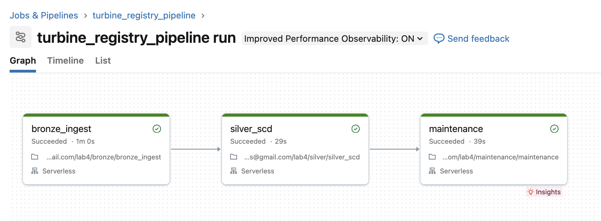
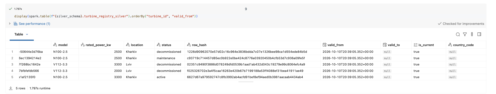
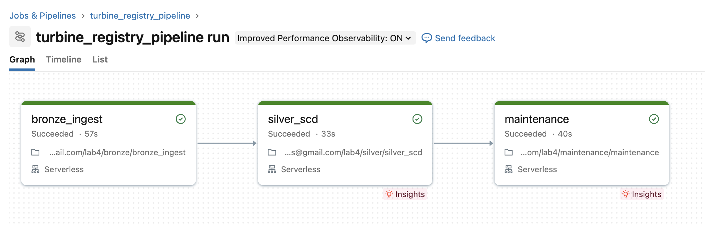
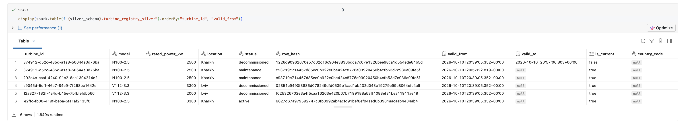
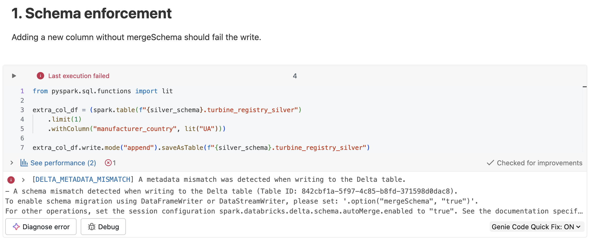
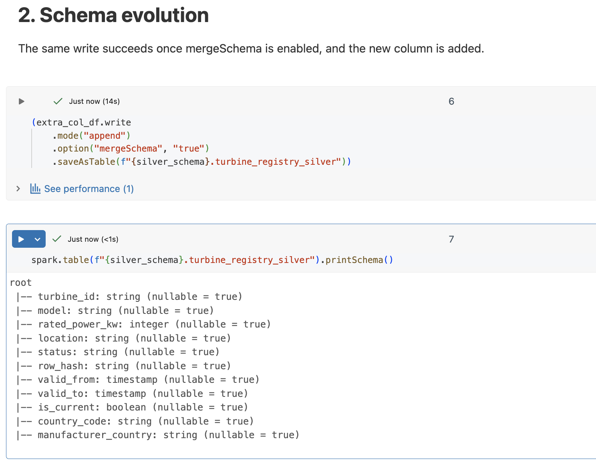
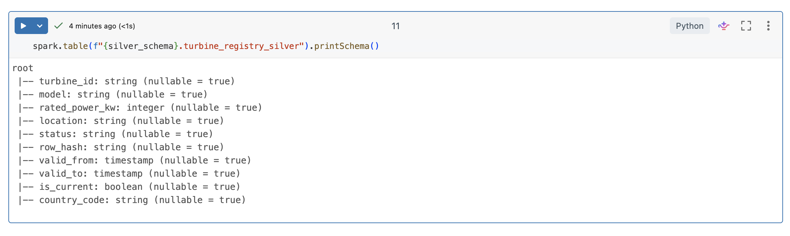
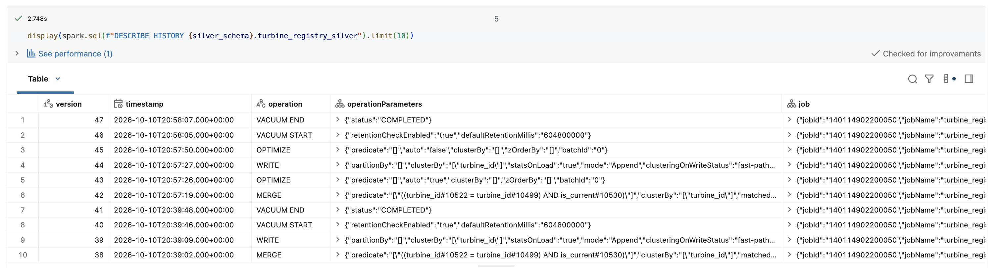
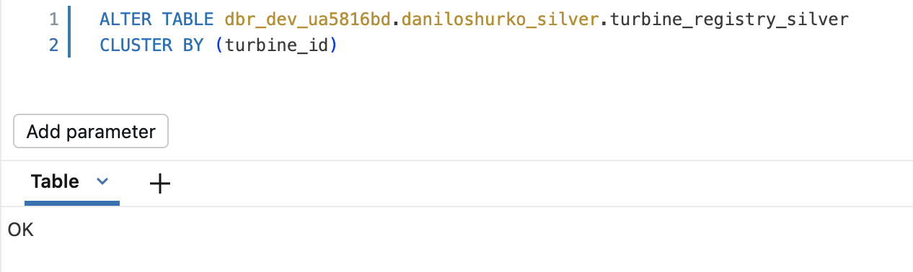
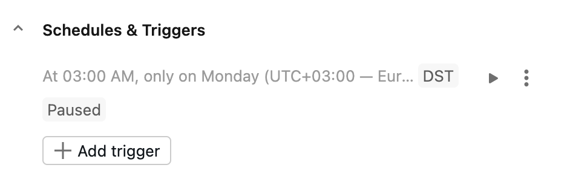

# Lab 4 – Silver Layer, Data Quality & Schema Evolution

Batch pipeline that ingests synthetic wind turbine registry snapshots into a
bronze table, applies SCD Type 2 history tracking into a silver table via
`MERGE`, and demonstrates schema enforcement, schema evolution and Delta
column mapping on top of it. Table maintenance (`OPTIMIZE`, `VACUUM`, Liquid
Clustering) is handled as a separate scheduled step.

## Data domain

Synthetic turbine registry (dimension-style data, not telemetry):

| column | description |
| --- | --- |
| `turbine_id` | business key (UUID) |
| `model` | turbine model name |
| `rated_power_kw` | rated power, kW |
| `location` | site location |
| `status` | `active` / `maintenance` / `decommissioned` |
| `source_ts` | timestamp of the source snapshot |

Data is generated locally by `bronze/generate_turbine_registry.py` and
uploaded manually to a Unity Catalog volume (no files are committed to the
repo).

## Architecture

```text
generator (local)
      │
      ▼
 raw/ (UC Volume, JSON snapshots)
      │
      ▼
bronze_ingest.py  →  <bronze_schema>.turbine_registry_bronze (append-only)
      │
      ▼
silver_scd.py     →  <silver_schema>.turbine_registry_silver (SCD2 via MERGE)
      │
      ▼
maintenance.py    →  OPTIMIZE / VACUUM / DESCRIBE HISTORY
```

All three notebooks are orchestrated as a single Databricks Job
(`turbine_registry_pipeline`) with job-level parameters `bronze_schema` and
`silver_schema`, so the same code runs unchanged on the personal account and
on the shared training cluster – only the parameter values differ.

## Repo structure

```text
bronze/
  generate_turbine_registry.py   # local generator, writes v1/v2 JSON snapshots
  bronze_ingest.py                # notebook: raw volume -> bronze table (append)
silver/
  silver_scd.py                   # notebook: bronze -> silver, SCD2 via MERGE
  schema_evolution_demo.py        # notebook: enforcement / evolution / column mapping
maintenance/
  maintenance.py                  # notebook: OPTIMIZE / VACUUM / DESCRIBE HISTORY
common/
  logging_utils.py                # shared logger, reused from Lab 3
docs/
  screenshots/                    # evidence screenshots, see below
.gitignore
README.md
```

## Running the pipeline

1. Generate a snapshot pair locally:

   ```bash
   python bronze/generate_turbine_registry.py
   ```

   This writes `snapshot_v1.json` and `snapshot_v2.json` to
   `bronze/out_files/` (git-ignored) and logs which turbine changed status
   between the two snapshots.
2. Upload `snapshot_v1.json` to the `raw` volume and run the
   `turbine_registry_pipeline` job. At this point the silver table has one
   current row per turbine and no history yet (`is_current = true`,
   `valid_to = null` for every row).
3. Upload `snapshot_v2.json` to the same volume and run the job again. The
   turbine whose status changed now has two rows in silver: a closed-out
   history row (`is_current = false`, `valid_to` set) and a new current row.

**Run 1 – job graph:**



**Run 1 – silver table, no history yet:**



**Run 2 – job graph:**



**Run 2 – silver table, SCD2 history row visible:**



Running the job twice in sequence is required to see SCD2 history – a
single run that already sees both snapshots at once would just load the
final state with no history, since schema enforcement/evolution and SCD
logic both operate on the latest `source_ts` per batch.

The pipeline is idempotent: re-running the job against the same snapshot
does not insert duplicate rows or change existing history (anti-join on the
business key for bronze, `MERGE` on the business key for silver).

## Schema enforcement, evolution and column mapping

`silver/schema_evolution_demo.py` demonstrates, on the silver table:

1. **Enforcement** – appending a DataFrame with an extra column
   (`manufacturer_country`) without `mergeSchema` fails with
   `DELTA_METADATA_MISMATCH`.
2. **Evolution** – the same write succeeds once
   `.option("mergeSchema", "true")` is set; the new column is added to the
   table schema.
3. **Column mapping** – `delta.columnMapping.mode = 'name'` is enabled on
   the table via `ALTER TABLE ... SET TBLPROPERTIES`, then the column is
   safely renamed with `ALTER TABLE ... RENAME COLUMN manufacturer_country
   TO country_code`, without rewriting existing data files.

**Enforcement failure:**



**Evolution success:**



**After column mapping rename:**



Because the silver table's column set can grow, `silver_scd.py` uses an
explicit column list in its `INSERT INTO ... SELECT` statement instead of a
positional insert, so schema evolution added by the demo notebook does not
break the regular pipeline run.

### On data contracts

Schema enforcement (reject on mismatch) and controlled evolution
(`mergeSchema`/`autoMerge` plus column mapping for safe renames) together
act as a lightweight data contract between bronze and silver: unexpected
schema drift fails loudly instead of silently corrupting the table, and
intentional changes are applied explicitly rather than inferred.

## Table maintenance

`maintenance/maintenance.py` runs:

- `OPTIMIZE <silver_schema>.turbine_registry_silver` – compacts small files
  produced by frequent `MERGE` writes.
- `VACUUM <silver_schema>.turbine_registry_silver RETAIN 168 HOURS` –
  removes files no longer referenced by any table version older than 7
  days, keeping enough history for time travel while bounding storage.
- `DESCRIBE HISTORY ... LIMIT 10` – used as the main evidence of maintenance
  activity, since `OPTIMIZE` on an already-compacted table reports zero
  files added/removed on a clean rerun (expected, not a bug).



The silver table also uses **Liquid Clustering** on `turbine_id`
(`ALTER TABLE ... CLUSTER BY (turbine_id)`) instead of classic partitioning
or `ZORDER`:

- Classic partitioning creates one folder per distinct value, which is a
  poor fit for a high-cardinality key like a turbine UUID (too many small
  partitions).
- `ZORDER` is a one-time rewrite performed during `OPTIMIZE` – it has to be
  re-run manually to stay effective as new data arrives.
- Liquid Clustering is maintained incrementally by Delta on every write and
  `OPTIMIZE`, without a full table rewrite, which fits an append/MERGE-heavy
  pipeline better.



## Scheduling

The `turbine_registry_pipeline` job is scheduled weekly (Monday 03:00,
Europe/Kyiv) and left in a **paused** trigger state on the personal account,
since this is a training exercise and not meant to run unattended.



## Screenshots index

All screenshots live in `docs/screenshots/`.

| file | what it shows |
| --- | --- |
| `01_job_run1_graph.png` | Job graph, first run, all 3 tasks succeeded |
| `02_job_run1_silver_no_history.png` | Silver table after run 1 – no history yet |
| `03_job_run2_graph.png` | Job graph, second run, all 3 tasks succeeded |
| `04_job_run2_silver_history.png` | Silver table after run 2 – SCD2 history row visible |
| `05_schema_enforcement_error.png` | `DELTA_METADATA_MISMATCH` without `mergeSchema` |
| `06_schema_evolution_success.png` | Write succeeds with `mergeSchema`, new column in schema |
| `07_column_mapping_rename.png` | Schema after `RENAME COLUMN` – `country_code` present, old name gone |
| `08_maintenance_describe_history.png` | `DESCRIBE HISTORY` showing `OPTIMIZE`/`VACUUM`/`MERGE` entries |
| `09_liquid_clustering.png` | `ALTER TABLE ... CLUSTER BY (turbine_id)` |
| `10_job_schedule_paused.png` | Job schedule, weekly Monday 03:00, status Paused |
